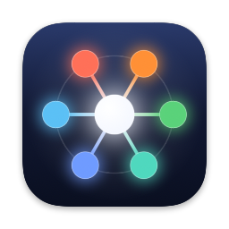
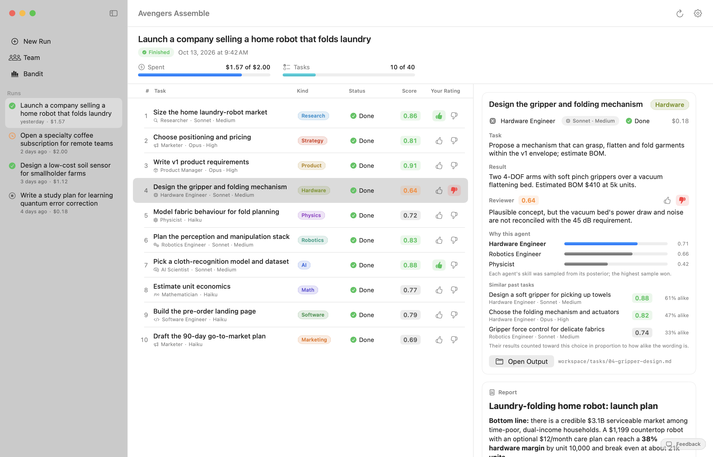
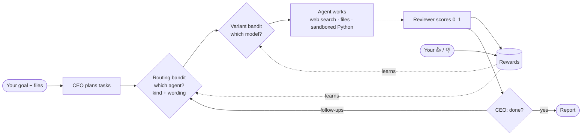
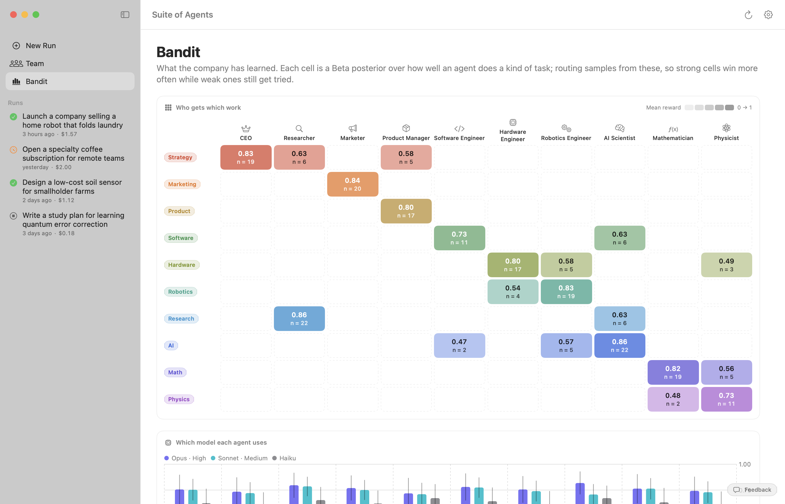
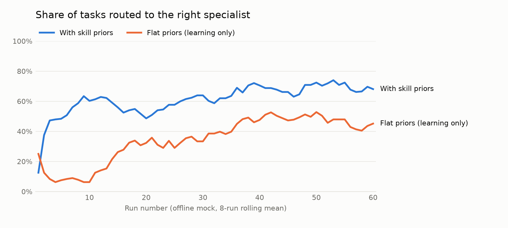
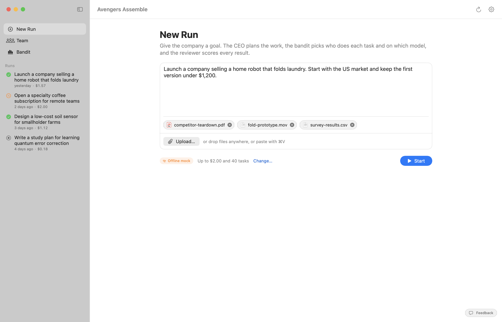
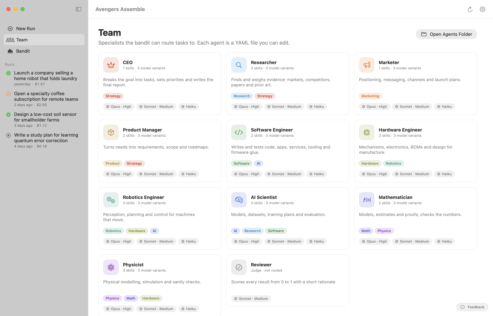

# Avengers Assemble

**A company made of AI agents: a CEO, a researcher, a marketer, product, software, hardware, robotics, AI, math and physics. Multi-armed bandits learn which agent, on which model, should do each task, from its kind and from what it says.**

<picture>
  <source media="(prefers-color-scheme: dark)" srcset="docs/images/run-dark.png">
  
</picture>

## How it works

<table>
<tr>
<td width="50%">
<picture>
  <source media="(prefers-color-scheme: dark)" srcset="docs/images/bandit-dark.png">
  
</picture>
</td>
<td width="50%">
<picture>
  <source media="(prefers-color-scheme: dark)" srcset="docs/images/bandit-learning-dark.png">
  
</picture>
</td>
</tr>
<tr>
<td>
<picture>
  <source media="(prefers-color-scheme: dark)" srcset="docs/images/new-run-dark.png">
  
</picture>
</td>
<td>
<picture>
  <source media="(prefers-color-scheme: dark)" srcset="docs/images/team-dark.png">
  
</picture>
</td>
</tr>
</table>

## Links

- **[Website](https://amalmehta.github.io/AvengersAssemble/)**: what it is, and the Mac download
- **[Instructions](docs/INSTRUCTIONS.md)**: set up, run and use it (Mac app and command line)
- **[System design](docs/SYSTEM-DESIGN.md)**: architecture, bandit maths, protocol, data, trade-offs, limits
- **[File structure](docs/FILE-STRUCTURE.md)**: what's where
