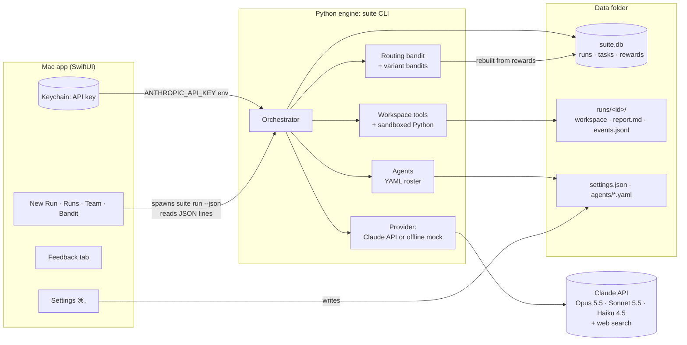

# Avengers Assemble: System Design

Avengers Assemble is a company made of AI agents. You give it a goal ("launch a company selling a home robot that folds laundry"). A CEO agent breaks the goal into tasks. Two layers of multi-armed bandits decide **which specialist** does each task and **which model** it runs on, based on the task's kind and on what the task says. A reviewer agent scores every result, and your 👍/👎 overrides the reviewer. The bandits learn from those rewards, so the team gets better at routing work the more you use it.

## Architecture

## Components

| Component | Where | Job |
|---|---|---|
| Mac app | `app/` | The UI. It starts and cancels runs, shows live progress, and records your ratings. It also browses past runs, the team and what the bandits have learned. Settings (⌘,), the feedback tab, and upload / drag-anywhere / ⌘V paste for input files live here too. It never calls the LLM itself. |
| CLI | `engine/src/suite/cli.py` | `suite run / runs / show / rate / agents / bandit / kinds`. Every command has `--json`, which is the app's only interface to the engine. |
| Orchestrator | `engine/src/suite/orchestrator.py` | Runs one goal: plan → route → work → judge → review (up to 3 rounds) → report. Runs independent tasks in parallel worker threads, enforces the budget and the task cap, and handles cancellation. |
| Bandits | `engine/src/suite/bandit.py` | Thompson sampling with Beta posteriors. The routing bandit has one arm per (kind, agent). Each agent has a variant bandit with one arm per (agent, model variant). Both are contextual: past results count toward a new task in proportion to how alike the wording is. |
| Similarity | `engine/src/suite/similarity.py` | TF-IDF vectors over task titles and descriptions, and their cosine similarity. Pure Python, computed locally. |
| Agents | `engine/src/suite/agents/*.yaml` → `<data>/agents/` | Name, role, skills (task kinds, primary skill first), allowed variants, and system prompt. Ten routable specialists plus the non-routable Reviewer. Edit them or add a file to add an agent. |
| Tools | `engine/src/suite/tools.py` | `write_file`, `read_file`, `list_files` confined to the run's workspace, and `run_python` under macOS `sandbox-exec`. `read_file` on an upload returns images and PDFs as native image and document blocks, and Office files as text. Web search is Anthropic's server-side tool. |
| Inputs | `engine/src/suite/inputs.py` | Prepares uploads once per run, sandboxed: HEIC → JPEG, TIFF/BMP → PNG, images downscaled to 1568 px; PDF page counts and text; DOCX/XLSX/PPTX → Markdown. Writes the CEO's planning digest. |
| Providers | `engine/src/suite/providers.py` | `AnthropicProvider` (Messages API with tools, structured outputs, effort and refusal fallbacks) and `MockProvider` (deterministic offline stand-in with the same interface). |
| Store | `engine/src/suite/store.py` | SQLite: `runs` and `tasks`. A task row holds its routing choice, judge score, your rating and cost, so it is also the reward log. |

## Main flows

**A run.** `suite run "<goal>" [--input file…]`
1. Uploaded files are copied to `runs/<id>/workspace/inputs/` and **prepared** (see "Uploads" below). The CEO gets a digest of them: name, type, size, pages or dimensions, and an excerpt.
2. **Plan.** The CEO (Opus 5.5, structured JSON output) returns 4–10 tasks, each with a kind (one of 10) and dependencies.
3. Every task whose dependencies have all finished is ready. Up to `max_parallel_tasks` (default 3) ready tasks run at once. For each one:
   - On the main thread, one task at a time, the **routing bandit** draws a sample for each routable agent from its Beta posterior for this task (its kind and its wording) and picks the highest.
   - That agent's **variant bandit** picks `opus-high`, `sonnet-medium` or `haiku` the same way. The samples and the 3 most similar past tasks are stored with the task as its routing evidence.
   - The agent runs a **tool loop** (up to `max_agent_steps`): web search, workspace files and sandboxed Python. It writes its deliverable to `workspace/tasks/NN-slug.md` and ends with a 2–3 sentence summary.
   - The **Reviewer** (Sonnet 5.5, structured output) scores the deliverable from 0 to 1 with a one-line rationale. That score is the reward.
   - The work and the review run on a worker thread. When a task finishes, the scheduler dispatches whatever has just become ready.
4. **Review.** The CEO reads all results and either declares the goal covered or adds up to 5 follow-up tasks (at most 3 rounds).
5. **Report.** The CEO writes `report.md` from the deliverables. If the run stopped early (budget, cancel or error), a plain report is assembled from the task summaries without an LLM call.

Every step emits a JSON-line event. The app renders them live, and they are also appended to `runs/<id>/events.jsonl`. With parallel tasks, events from different tasks interleave; each carries its `task_id`.

**Parallel execution.** Routing stays on the main thread, so bandit decisions are serialized. Tasks dispatched together don't see each other's rewards (batched Thompson sampling). In the mock simulation this didn't change where learning ends up: after 60 runs, 50% of tasks reached the best agent one at a time against 49% three at a time (mean of 4 simulations each). One lock guards spend, the counters, the event stream and the SQLite connection. Provider calls run outside the lock, so they overlap. If a worker hits an error or the budget, the scheduler stops dispatching, waits for tasks in flight to finish, then ends the run. On cancel, workers stop at their next API call and record nothing more.

**Uploads.** Agents read uploads on demand with `read_file`, so you pay for a file only when an agent opens it:

| Upload | Prepared as (once, at run start) | What `read_file` returns |
|---|---|---|
| PNG, JPEG, GIF, WebP | Downscaled to 1568 px on the long edge and under 3.7 MB (WebP that needs resizing becomes JPEG) | The image, as an image block the model sees |
| HEIC/HEIF (iPhone photos) | Converted to JPEG, same size limits | The image |
| TIFF, BMP | Converted to PNG | The image |
| PDF | Page count and extracted text | ≤ 20 pages: the real PDF as a document block (text, tables and figures). Longer: the extracted text of 20 pages and how to page through; `pages: "12-18"` returns up to 20 pages as a real PDF |
| DOCX, XLSX, PPTX | Markdown: headings, paragraphs and tables; sheets as tables (first 200 rows); slides with speaker notes | The Markdown text |
| Text and code | Nothing | The text |
| Anything else | Nothing | A note that it's binary; `run_python` can inspect it (pypdf, python-docx, openpyxl and python-pptx are importable) |

Prepared copies live in `inputs/.prepared/`, hidden from `list_files`; the original stays as uploaded. A file that can't be parsed is reported in the digest and as a `read_file` error; the run continues.

**Rating.** `suite rate <task> up|down|clear` stores `user_rating` (1/0/null). Posteriors are rebuilt from the task table on every routing decision, so a rating takes effect on the next task, even mid-run.

**Learning maths.** For a task with reward *r* ∈ [0,1] and weight *w*, the arm gets α += w·r and β += w·(1−r). If you rated the task, *r* is your rating and *w* is `user_rating_weight` (default 3). Otherwise *r* is the judge's score and *w* is 1. The variant arm is paid *r* − `cost_penalty_per_usd` × task cost, so a cheap model that is nearly as good wins over time.

**Routing on what a task says.** A task's kind is coarse. "Design the battery and thermal system" is a hardware task that a physicist may do best. So when choosing for a new task *x*, every past result *i* counts with a kernel weight *k* rather than all or nothing:

- routing: *k* = (1 − *t*)·[same kind] + *t*·cos(*x*, *xᵢ*)
- variants: *k* = (1 − *t*) + *t*·cos(*x*, *xᵢ*)

Here cos is the TF-IDF cosine between the two tasks' titles and descriptions, and *t* is `text_weight` (default 0.5). Each result then adds *k*·w·r to α and *k*·w·(1−r) to β. A past task with similar wording lends its evidence even across kinds, and two tasks of the same kind with different wording no longer share one posterior. With *t* = 0 it is exactly the kind-only bandit. The Bandit view shows the kind-level posteriors (*t* = 0); each task's own evidence appears under "Why this agent".

**Priors.** Routing arms start from the agent's declared skills: primary skill Beta(4,1), secondary skill Beta(2.5,1), anything else Beta(1,2). Variant arms start flat at Beta(1,1). With ten agents per kind, flat routing priors let the luckiest of nine non-specialist draws win too often.

**What the simulation shows** (`scripts/bandit_chart.py`; mean of 4 simulations of 60 runs each). The mock judge rewards the best agent for each task: usually the kind's specialist, but some wording ("battery", "pricing", "gripper"…) calls for a different expert, the way real work does.

| Routing | Best agent, runs 1–10 | Best agent, runs 41–60 |
|---|---|---|
| Kind + task wording (default) | 35% | 50% |
| Kind only | 36% | 43% |
| Kind only, flat priors | 13% | 33% |

Wording only helps once there is history to match against: the two lines track each other for about 40 runs. The skill priors anchor routing strongly (5 pseudo-observations for a specialist), so overturning one takes several direct results. Raising `text_weight` to 0.8 gave no further gain in the mock.

## Engine ↔ app protocol

The app finds `uv` and runs `uv run --project <engine> suite <command> --json`, with `UV_PROJECT_ENVIRONMENT=<data>/venv` (so no venv is written inside the app bundle) and `ANTHROPIC_API_KEY` from the Keychain.

| Command | Output |
|---|---|
| `run "<goal>" [--input P]… [--mock] [--max-cost $] [--max-tasks N] [--parallel N]` | JSON lines (events below) until `run_finished`. SIGTERM → status `canceled`. |
| `runs` | `[{id, goal, status, created_at, spent_usd, task_count, mock}]`, newest first |
| `show <run_id>` | `{run: {…, report, workspace}, tasks: [Task]}` |
| `rate <task_id> up\|down\|clear` | `{ok, task_id, rating}` |
| `agents` | `[{id, name, role, skills, variants, routable, path}]` |
| `bandit` | `{kinds, routing: [{kind, agent, alpha, beta, mean, n}], variants: [{agent, variant, alpha, beta, mean, n}]}` |
| `kinds` | `[{id, name, family}]` |

Task: `{id, run_id, seq, round, title, description, kind, depends_on, status, agent, variant, summary, output_path, judge_score, judge_rationale, user_rating, cost_usd, routing}`. `output_path` is relative to `runs/<id>/`. `routing` is `{samples, similar}` as in `task_assigned`, or null for tasks routed before it existed.

| Event | Fields |
|---|---|
| `run_started` | run_id, goal, mock, max_cost_usd, max_tasks |
| `inputs` | files: [{name, kind (`pdf`/`image`/`office`/`text`/`binary`/`unreadable`), bytes, pages, width, height, error}] (only when files were uploaded) |
| `plan` | round, tasks |
| `task_assigned` | task_id, kind, agent, variant, samples (the Thompson draw for each agent), similar (up to 3 past tasks: task_id, title, kind, agent, variant, reward, similarity) |
| `tool_call` / `agent_text` | task_id, tool + summary / text |
| `task_finished` | task_id, status, summary, output_path, cost_usd |
| `task_scored` | task_id, score, rationale |
| `budget` | spent_usd, max_cost_usd, tasks_done, max_tasks |
| `run_finished` | run_id, status (`done`/`budget`/`canceled`/`error`), report_path, spent_usd |
| `error` | message |

## Where data lives

All data lives in `SUITE_HOME`, by default `~/Library/Application Support/Avengers Assemble/`:

| Path | Contents | Written by |
|---|---|---|
| `settings.json` | `mock`, `max_cost_usd` (2), `max_tasks` (40), `user_rating_weight` (3), `cost_penalty_per_usd` (0.2), `max_agent_steps` (10), `max_parallel_tasks` (3), `text_weight` (0.5) | App Settings |
| `agents/*.yaml` | The editable roster, seeded from the defaults on first use | You |
| `suite.db` | Runs and tasks (the reward log) | Engine |
| `runs/<id>/workspace/` | `inputs/` (your uploads, with model-ready copies in `inputs/.prepared/`) and `tasks/` (deliverables), plus any code or data the agents made | Agents |
| `runs/<id>/report.md`, `events.jsonl` | The final report and the full event log | Engine |
| `feedback.jsonl` | Feedback-tab entries (local only) | App |
| `venv/` | The engine's Python environment when launched from the app | uv |

The API key lives only in the macOS Keychain (service "Avengers Assemble"). It is passed to the engine as an environment variable and is never written to disk. The Python sandbox starts with an empty environment, so code the agents write can't read the key.

**From the old name.** The project was called Suite of Agents until 2026-10-14. The first time the app or the `suite` command runs, it moves a `Suite of Agents` data folder to `Avengers Assemble` and deletes the Python environment inside, which holds absolute paths and is rebuilt on the next run; if both folders exist, nothing moves. A saved API key moves to the new Keychain entry when first read, and the app's uv and engine overrides carry over from the old bundle ID. Internal names keep the old one: the `suite` command, the `suite` Python package, `SUITE_HOME`, and the Swift package and targets (`SuiteOfAgents`, `SuiteCore`).

## Key design decisions and trade-offs

- **Two processes (Swift UI + Python engine) over one Swift app.** Python has the official Anthropic SDK and is easy to script, test and run headless (`suite run …` works without the app). The cost is a `uv` dependency and a JSON protocol to keep in sync.
- **Thompson sampling over UCB or ε-greedy.** It handles fractional rewards and informative priors naturally, explores in proportion to uncertainty, and has no tuning constant. Contextual variants like LinUCB need far more data than one person's runs; a kernel over past results keeps the same Beta posteriors, priors and explanations.
- **Posteriors recomputed from the task table** rather than stored as counters. Ratings and edits to priors apply retroactively, and nothing can drift out of sync. The cost is O(tasks) per decision, which is trivial at this scale.
- **Kinds plus wording as the routing context.** Ten fixed kinds keep the arm count manageable (10 × 10 routing arms), give the app a stable colour scheme, and carry the skill priors. Task wording refines that through the similarity kernel.
- **Local TF-IDF over embeddings.** It is free, offline, deterministic and works with the mock. The cost: it matches shared words, not paraphrase ("BOM" and "bill of materials" don't match). Posteriors are recomputed per decision in O(number of past tasks), fine for thousands of tasks.
- **LLM judge + weighted human rating.** The judge makes learning automatic. Your rating outranks it 3:1 because the judge can share the agents' blind spots.
- **Parallel tasks on threads, routing on one thread.** Agent work is almost entirely waiting on the API, so threads give real overlap without the cost of extra processes. Keeping routing serialized keeps bandit decisions simple and lets tests reason about them. The trade-offs: batched decisions use slightly staler posteriors, and the budget check happens before each call, so with N tasks in flight a run can overshoot its cap by up to N calls. Set "Tasks at once" to 1 for exact sequential behaviour.
- **Uploads read natively, on demand, rather than converted to text up front.** Claude reads a PDF's tables and figures and sees an image as it is, which no text conversion keeps; and a file costs tokens only when an agent opens it. The trade-off: an opened file stays in that agent's conversation, so it's re-sent on each later step of the task (a 20-page PDF is tens of thousands of tokens per step). The 20-page cap bounds one read, and downscaling at ingestion keeps images small, sized before any request carries them, never edited afterwards.
- **Safety.** No send, buy or publish tools. Code runs in a `sandbox-exec` profile that denies network access and writes outside the workspace. Uploads are untrusted, so parsing them is sandboxed too: PDFs and Office files are parsed in a child process under that same profile, with a 90 s limit. Images are decoded only by Apple's `sips`, under a profile that also allows the per-user temp folder `sips` needs (still no network, and nothing in your home folder). Every run has a dollar cap and a task cap. Opus and Sonnet requests use `fallbacks: "default"`, so a safety-classifier decline is retried on Anthropic's recommended fallback model instead of failing the task.
- **Offline mock as a first-class provider.** The whole system (app included) runs, demos and tests with no key and no cost. The mock judge rewards specialists and stronger models, with noise, so bandit learning is observable.

## Testing

`cd engine && uv run pytest`:
- **Bandits.** The skill prior favours specialists. Learning overrides a wrong prior. Your rating replaces and outweighs the judge. The variant bandit pays for cost.
- **Tools.** Path escapes are rejected. The sandbox blocks network access and writes outside the workspace.
- **Uploads.** Each format end to end: short PDFs come back native and long ones as text with working page ranges (checked by reading the sliced PDF); bad ranges are rejected. Large images are downscaled; HEIC becomes JPEG and TIFF becomes PNG, with originals untouched. DOCX/XLSX/PPTX become Markdown with tables and notes. Broken and binary files fail gracefully, and prepared copies stay hidden. Both conversion sandboxes block network and writes outside their allowed folders. A mock run gives every agent the PDF as a native document. Through the fake transport, the plan prompt carries the digest and the upload reaches the API as a `document` block inside `tool_result`.
- **Orchestration (mock).** A full run covers the event sequence, both rounds, inputs copied, the report and the event log. The budget cap and task cap each stop a run cleanly with a report. Learning across runs is checked too.
- **Real provider via fake HTTP transport.** The exact request shape is checked: model IDs, effort, `fallbacks: "default"` with its beta header, tool list, the web-search tool version per model, structured outputs and cost arithmetic. A whole run is driven against scripted API replies, including the tool loop echoing assistant blocks unchanged.
- **Parallel execution.** Overlap reaches the limit and dependencies are respected (no task starts before its dependencies finish). Parallel runs are faster than sequential ones, and a limit of 1 never overlaps. The task cap counts dispatched tasks. The budget cap and worker errors drain tasks in flight with none left `running`. Concurrent `run_python` calls don't collide.
- **Text routing.** Tokenizing and cosine. `text_weight` 0 is exactly kind-only. Similar wording carries evidence across kinds, and none transfers without shared words. Wording splits one kind between two agents where kind-only can't. The variant bandit learns per wording (Opus for proofs, Haiku for summaries). The closest past tasks are listed in order. Old databases gain the `routing` column. Runs store their routing evidence and `show` returns it.
- **CLI.** Every `--json` command, plus SIGTERM → `canceled` (with parallel tasks in flight).
- **App.** `cd app && swift test` covers event and routing-evidence decoding, a streamed run with a pasted image (agents receive it as an image), settings, and the colour palette (families share a hue range; siblings are distinguishable). With `SUITE_ENGINE_DIR` set, it also checks that real `show` output carries routing evidence.

## Known limits

- The live Claude path has been tested only against a fake transport. No API key was available during the build, so the first real run is the first live test. Start with a low budget.
- With several tasks in flight, a run can overshoot its cost cap by up to one API call per running task.
- Task similarity is lexical (TF-IDF). Paraphrases with no shared words don't match, and very short task descriptions give weak signals.
- Wording-aware routing pays off only after many runs, and its gain in simulation is moderate (43% → 50% best-agent routing). The mock's variant rewards don't depend on wording, so the variant side is covered by unit tests, not simulation.
- `sandbox-exec` is deprecated by Apple (though still functional). It confines writes and network access, not CPU or memory beyond the 60 s timeout.
- Costs are computed from list prices in `config.py` and must be updated when prices change. On a refusal fallback, all attempts are priced at the requested model's rates.
- A PDF longer than 20 pages comes back as extracted text unless an agent asks for a page range; a scanned PDF has no text layer, so its pages must be opened by range to be read.
- An opened PDF or image is re-sent on every later step of that agent's task, which adds cost on long tasks.
- Image conversion needs macOS (`sips`). Spreadsheets show their first 200 rows per sheet as text; formulas appear as their last saved values.
- Preparing uploads takes about 1–2 s per file, longer for very large photos (a 20 MB HEIC took about 10 s).
- The app needs `uv` installed (`curl -LsSf https://astral.sh/uv/install.sh | sh`).
